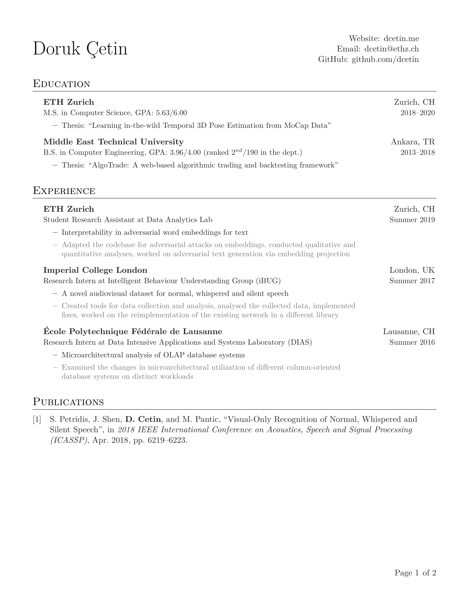
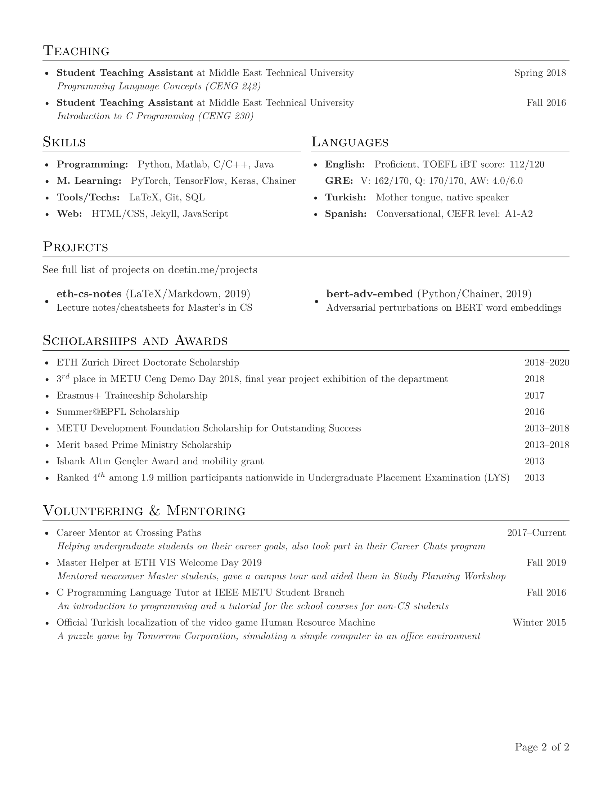
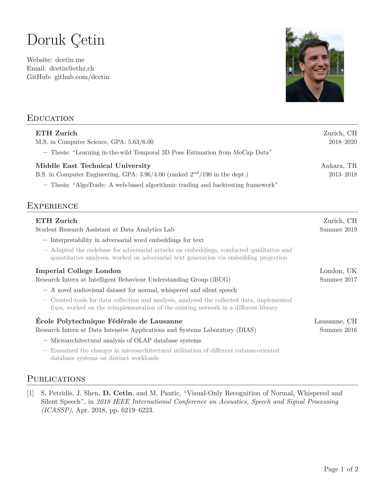
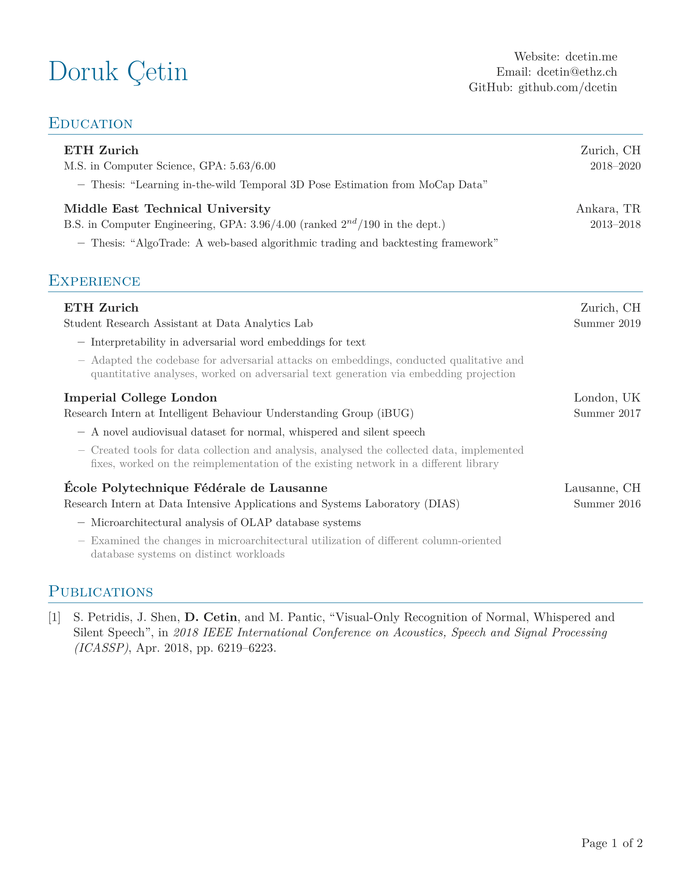
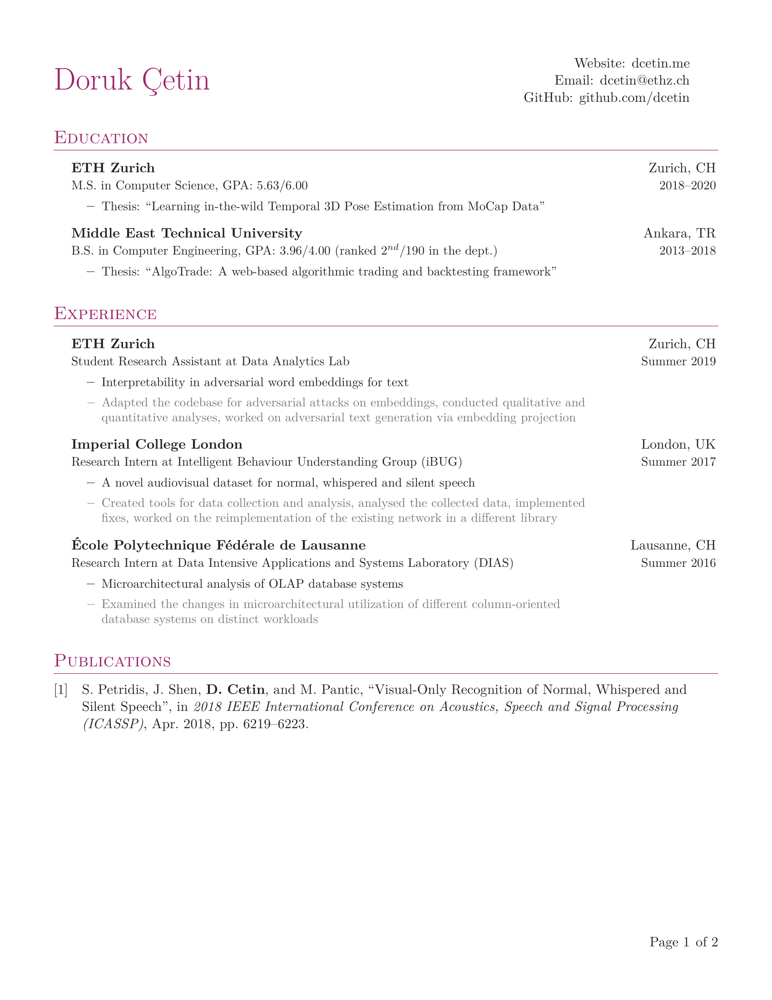

# Simple-CV

XeLaTeX CV for Behzat Bilgin Erdem. Layout is based on the Simple-CV template.

## Tailor it to a job

1. Paste the job description into `description.txt`, under the header. Delete the previous job first.
2. Leave `experiences.txt` as the fact list. Add a new role there when your history changes. Do not put the job description in that file.
3. Open this folder in the agent and say:

```
Follow skills/tailor-cv/SKILL.md
```

4. Open `main.pdf`.

Tools that load `AGENTS.md` (Cursor, Codex, and others) already know to follow that skill. A local model that cannot see the folder needs the same sentence plus the contents of `skills/tailor-cv/SKILL.md`, `description.txt`, `experiences.txt`, `main.tex`, and `sections/`.

The skill keeps the PDF to one or two pages, changes wording only where `experiences.txt` already supports it, and leaves both input files untouched.

## Compile by hand

XeLaTeX, from the repo root. Run it twice so the page numbers settle. Perl is not installed, so `latexmk` will fail.

```bash
xelatex -interaction=nonstopmode -halt-on-error main.tex
xelatex -interaction=nonstopmode -halt-on-error main.tex
```

## Template notes

You can either fill the [basic template on Overleaf](https://www.overleaf.com/latex/templates/simple-cv/wmsyrgqwwqnc), or edit the example CV provided here.
Note that the template needs to be compiled with XeLaTeX or LuaLaTeX.
Code is tested on Windows with Texmaker/Biber/MikTeX.

After installing all the necessary packages, following sequence fo commands should produce the pdf:
```bash
xelatex main.tex
biber main
xelatex main.tex
xelatex main.tex
```

Alternatively, a single command would suffice if perl is available:
```bash
latexmk -xelatex -bibtex-cond1 -silent main.tex
```

To use the alternative headers just uncomment the relevant lines in the main tex file (and replace the photo with yours, if you are using `\headingphoto`). Social media icons are from fontawesome package, see [its reference](https://mirrors.ibiblio.org/CTAN/fonts/fontawesome/doc/fontawesome.pdf) for a list of all available icons.
Theme color and bibliography style can similarly be set at the top of the main tex file. See [Colors entry in LaTeX wikibooks](https://en.wikibooks.org/wiki/LaTeX/Colors) for more predefined colors.
Template also supports Chinese and Cyrillic characters, you just need uncomment the relevant lines in the preamble.

## Preview

First page                 | Second page
:-------------------------:|:-------------------------:
|

Header with photo                | Blue theme               | Red theme
:-------------------------------:|:------------------------:|:---------------------:
 ||

## License

Available under [the MIT license](https://opensource.org/licenses/MIT), but all the data is owned by me.
